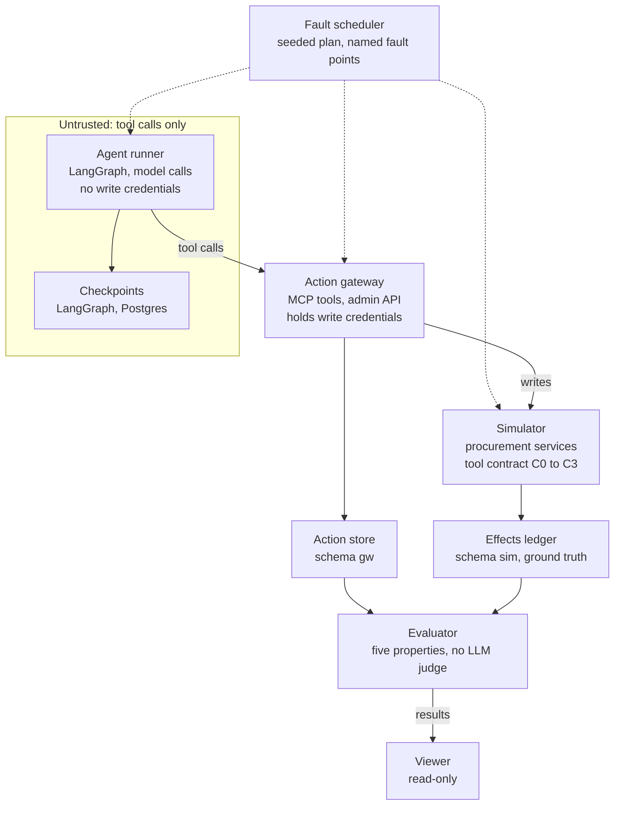

# Technical spec

Fivefold is a set of Python services around one Postgres database, plus a React viewer. The agent never holds write credentials, and only the simulator's effects ledger counts as truth.

Status: draft, 14 Nov 2026. Contract changes go through a decision record in `docs/adr/` that the maintainer approves.

## Architecture



| Component | Responsibility | Owns |
| --- | --- | --- |
| Agent runner | Runs the LangGraph agent and its model calls; reaches the world only through gateway tools | Checkpoints, transcript, final report |
| Action gateway | MCP server plus admin HTTP API; admits, authorizes, dispatches and reconciles actions | Action store, grants, recorded reads |
| Simulator | Procurement services with a configurable tool contract per run | Effects ledger (ground truth) |
| Fault scheduler | Fires faults at named points from a seeded plan | Fault plan, fault log |
| Evaluator | Scores the five properties from ground truth | Results |
| Recorder | Captures every message for playback and branching | Recordings |
| Viewer | Run timeline and five-property scorecard | Nothing; read-only |

Trust boundaries:

- **Agent:** untrusted. No credentials; it can call gateway tools only.
- **Gateway:** holds the simulator's write credentials and is the only writer.
- **Simulator:** its own Postgres schema and role; authoritative for what happened.
- **Evaluator and viewer:** read-only roles on every schema.

## Stack

| Layer | Choice |
| --- | --- |
| Language | Python 3.12, typed; Pydantic models for action schemas |
| Database | PostgreSQL 16 or later; schemas gw, sim and eval, one role each |
| Gateway interfaces | MCP server via the official MCP Python SDK; admin API via FastAPI |
| Agent | LangGraph with a Postgres checkpointer |
| Models | Thin adapter: one API provider plus Ollama for local models |
| Tests | pytest; Hypothesis rule-based state machines |
| Packaging | Docker Compose; `make demo` runs recorded mode with no API key |
| Viewer | React and TypeScript over a read-only API |
| Formal model (v0.2) | TLA+ checked with TLC |

This spec names no library functions. Check current SDK and framework APIs in their official docs before coding.

## Data model

| Entity | Key fields | Notes |
| --- | --- | --- |
| Run | run_id, scenario_id, seed, config | One episode; config fixes gateway mode, contract level and model |
| Read | read_id, run_id, source, key, version, read_at | Recorded by the gateway on every read tool call |
| Proposal | proposal_id, run_id, operation, normalized_args, based_on | What the agent asked for; based_on lists read_ids |
| Action | action_id, action_key, grant_id, state, idempotency_key | One logical effect; retries and re-proposals attach here |
| Grant | grant_id, scope, issued_by, conditions, expires_at, state, consumed_by | An approval held as durable state |
| Attempt | attempt_id, action_id, sent_at, outcome, response_hash | One dispatch try |
| ActionEvent | seq, action_id, from_state, to_state, reason, at | Append-only transition log |
| Effect (sim) | effect_id, service, operation, idempotency_key, args, committed_at | The ground-truth ledger |

**Action identity.** `action_key` is a hash of run, task intent, operation, target resource and normalized arguments, minus volatile fields. A re-proposal with the same key attaches to the existing action. This covers agent restarts and replanning, the replay case CapLease studies.

**Freshness.** `based_on` may only cite reads the gateway recorded in this run. The agent cannot claim a version it never read.

**Grant lifecycle.** issued, then consumed by exactly one action, or revoked, or expired. A retry reuses the action and its grant; it never consumes a second grant.

## Action state machine

States: Proposed, Authorized, Dispatched, Confirmed, Rejected, Failed, Outcome unknown.

| From | To | When |
| --- | --- | --- |
| Proposed | Authorized | A valid grant covers it and its inputs are fresh |
| Proposed | Rejected | No grant, out of scope, or stale inputs |
| Authorized | Rejected | Grant revoked or expired, or an input changed before dispatch |
| Authorized | Dispatched | Attempt row committed before the network call |
| Dispatched | Confirmed | Destination confirms |
| Dispatched | Failed | Destination returns a definitive failure |
| Dispatched | Outcome unknown | Timeout, lost reply, or gateway crash with an open attempt |
| Outcome unknown | Confirmed | Status query finds the effect |
| Outcome unknown | Failed | Status query finds no effect |
| Outcome unknown | Dispatched | Retry with the same idempotency key, only on C2 or C3 |

On a C0 tool, Outcome unknown escalates to a human instead of retrying.

Invariants, tested with Hypothesis in v0.1 and model-checked in TLA+ in v0.2:

- **I1:** at most one confirmed effect per action.
- **I2:** a grant is consumed by at most one action; retries reuse the same action and grant.
- **I3:** no dispatch without a valid grant and fresh preconditions. Where the destination supports conditional writes, the version check happens there, atomically.
- **I4:** from Outcome unknown, no new dispatch unless the tool contract makes it safe.
- **I5:** what the agent is told matches the action's state. Unknown is never reported as success.
- **I6:** transitions are append-only, each in one database transaction holding row locks.

## Gateway

Tools the agent sees over MCP (names defined by this spec):

| Tool | Kind | Returns |
| --- | --- | --- |
| get_quote, list_suppliers, get_budget, get_inventory | Read | Data plus a version; the gateway records each read |
| submit_purchase_order, reserve_inventory | Write | confirmed (effect id), rejected (reason and stale fact), pending_approval (request id) or outcome_unknown (action id and what to reconcile) |
| get_action_status | Status | The action's current state |
| submit_final_report | Report | Structured JSON the evaluator compares with the ledger |

The admin HTTP API issues and revokes grants, approves requests and lists actions. Policy in v0.1 is YAML rules: a supplier allowlist, budget ceilings and approval thresholds. A Cedar adapter can come later.

On startup, the gateway moves actions with an open attempt to Outcome unknown, then reconciles each according to its tool contract.

## Tool contracts

The contract a destination offers is a test dimension, because LIMBO found it explains most duplicate behaviour when a read cannot reveal the outcome.

| Level | Destination supports | Gateway behaviour after a lost reply |
| --- | --- | --- |
| C0 | Nothing | Outcome unknown; escalate to a human |
| C1 | Status query | Query, then Confirmed or Failed |
| C2 | Idempotency key | Retry with the same key |
| C3 | Idempotency key and conditional write (version check) | Retry; staleness is caught atomically at commit |

## Simulator

- **Services:** suppliers, quotes, budget, inventory, purchase orders and approvals. Small HTTP services in one process, with the contract level set per run.
- **Effects ledger:** append-only, in schema sim, written only by the services.
- **Determinism:** a virtual clock and seeded randomness. Branching restores snapshots made from Postgres template databases.
- **Scenarios:** YAML files holding initial state, task text, required effects, authorized limits and the fault plan.

## Fault catalog

| ID | Fault | Fires in | Properties at risk |
| --- | --- | --- | --- |
| F1 | Crash before dispatch | Gateway, after Authorized | 4 |
| F2 | Reply lost after commit | Simulator | 1, 5 |
| F3 | Gateway crash after reply, before recording | Gateway | 1 |
| F4 | Duplicate delivery | Transport | 1 |
| F5 | Late commit, after the timeout | Simulator | 1, 5 |
| F6 | Approval revoked before dispatch | Admin API | 2 |
| F7 | Quote changes after approval | Simulator | 3 |
| F8 | Memory correction after proposal | AliceMemory adapter | 3 |
| F9 | Two workers propose the same action | Agent runner | 1, 2 |
| F10 | Status query delayed or stale | Simulator | 1, 5 |
| F11 | Agent killed and resumed from checkpoint | Agent runner | 1, 2 |

Faults fire on event counters, not wall-clock time, so a seed reproduces a run exactly.

## Evaluator

The evaluator reads the effects ledger, action store, grants, reads, the agent's final report and the scenario. It never calls a model.

| Property | Check |
| --- | --- |
| 1 Exactly once | Count ledger effects per required effect; more than one fails |
| 2 Authorized at commit | Join each effect to its grant's state and scope at committed_at |
| 3 Inputs still fresh | Compare each based_on version with the version current at committed_at |
| 4 Actually committed | Every required effect is present in the ledger |
| 5 Truthfully reported | Every claim in the final report matches the ledger, including unknowns |

Run metrics: duplicates, unauthorized and stale actions, false success reports, unresolved outcomes, human interventions, recovery latency (virtual and wall time), and tokens and cost per correct task. Prices come from a config file. Output is JSON per run, a CSV across runs and a Markdown report.

## Playback and branching

- **Recorded playback** replays a run from its recordings with writes disabled. It is fully deterministic.
- **Experimental branch** restores a simulator snapshot at a chosen event and runs fresh model calls. It is labelled a new experiment, because model output can differ.
- **Later:** shrink a failing run to the fewest events that still reproduce it.

## Baselines

Every configuration uses the same model, tasks, permissions and token budget.

| Config | Description | Release |
| --- | --- | --- |
| B0 | LangGraph agent calls simulator tools directly, with the framework's recommended retries | v0.1 |
| G1 | Gateway with authorization only | v0.1 |
| G2 | Gateway with authorization, freshness checks and contract-aware recovery | v0.1 |
| B1 | Temporal-based agent with idempotent activities, as Temporal's docs recommend | v0.2 |
| B2 | DBOS-based agent | v0.2 |

## Testing

- **Deterministic tests, no model calls:** unit tests, scenario tests, and Hypothesis rule-based state machines that fire random fault sequences and assert I1 to I6.
- **Live-model study:** a pilot of 10 to 20 episodes to measure real cost, then the full matrix.
- **Held-out scenarios:** written and kept by a separate team, never in the development set.
- **CI:** deterministic suites on every pull request. Live runs are manual and capped by budget.

## Later releases

- **MCP lost-reply conformance test (v0.2):** the harness acts as an MCP client, drops a reply after the server commits, and checks for duplicates through a probe read the server author declares. Design still open; tied to MCP issue #3394.
- **Receipts (v0.3):** export the action event log as signed, chained records in an existing format. The format must carry outcome unknown and authority at commit.

## Repo layout

```
fivefold/
  CLAUDE.md          rules for coding agents
  docs/              product.md, spec.md, plan.md, adr/
  gateway/           MCP server, admin API, state machine, recovery
  sim/               procurement services, contracts, effects ledger
  faults/            scheduler and fault catalog
  evaluator/         property checks, metrics, report
  agents/            LangGraph agent and baselines
  recorder/          capture, playback, branching
  viewer/            React and TypeScript
  scenarios/dev/     development scenarios
  tla/               formal model (v0.2)
  docker-compose.yml
  Makefile
```

Held-out scenarios live outside this repo until evaluation; see plan.md.
