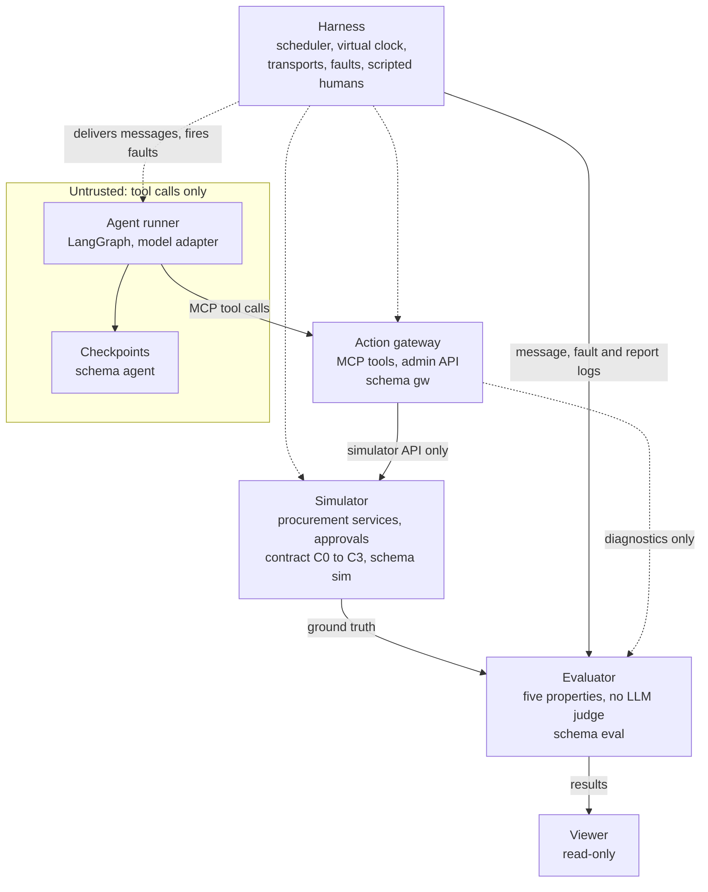

# Technical spec

FiveFold is a set of Python services around one Postgres database per run, plus a React viewer. In gateway configurations the agent holds no simulator credential, and only the simulator's and the harness's records count as truth.

Status: M0 decisions accepted, 14 Nov 2026. This spec states the contracts. Decision records 0001 to 0023 in `docs/adr/` hold the reasoning and the full detail, and that detail is binding too. Contract changes go through a new decision record that the maintainer approves.

## Architecture



In the baseline configurations, the agent calls the simulator API directly and there is no gateway.

| Component | Responsibility | Owns |
| --- | --- | --- |
| Agent runner | Runs the LangGraph agent and its model calls; reaches the world only through tools | Checkpoints (schema `agent`) |
| Action gateway | MCP server and admin API; admits, authorizes, dispatches and reconciles actions; checks final reports in G2 | The action store (schema `gw`) |
| Simulator | Procurement services and the approvals service, which is the system of record for authority; the effects ledger, fact history and read log; contract capabilities set per run | Ground truth (schema `sim`) |
| Harness | Deterministic scheduler, virtual clock, transports, fault injection, scripted approver and resolver, run lifecycle, report sink | Message, fault and actor logs, final reports (schema `harness`) |
| Evaluator | Scores the five properties from simulator and harness records | Results (schema `eval`) |
| Recorder | Records model requests and responses into cassettes for replay | Cassettes |
| Viewer | Run timeline and five-property scorecard | Nothing; read-only |

## Configurations

Detail: 0008, 0018 and 0020.

Version 0.2.0 includes B1, B2 and the MCP lost-reply conformance test (0019).

| Config | Write path | Features |
| --- | --- | --- |
| B0 | The agent calls the simulator API directly | The framework's retries only |
| G1 | Through the gateway | Authorization only: one approval per call, checked before a single send |
| G2 | Through the gateway | Authorization, action identity, freshness checks, contract-aware recovery, report checks |
| B1 (0.2.0) | A Temporal agent calls the simulator API directly through the harness | Shared scripted policy, durable Activity results, Activity retries and a stable key per write Activity at C2 and C3 (0018) |
| B2 (0.2.0) | A DBOS agent calls the simulator API directly through the harness | Shared scripted policy, durable Step results, up to three attempts per Step and a stable key per write Step at C2 and C3 (0020) |

B1 and B2 run the scripted model only. Install the SDK with
`pip install "fivefold[temporal]"` or `pip install "fivefold[dbos]"`. For
B1, run `make temporal-setup` or set `FIVEFOLD_TEMPORAL_CLI` to the pinned
binary. B1 allows 30 s for a handoff, or 130 s after a failed or lost
attempt (#124). An expired handoff stops the episode before scoring.
[Study setup and cleanup](studies.md)

All configurations in one comparison use the same model, task text, intents, authority policy, token budget and step budget. B0, G1 and G2 share one LangGraph agent: a model node and the prebuilt tool node, with the library's default error handling and a retry policy with library defaults. 0008 lists the facts behind that choice, checked in library source, and the scripted agent policy used by deterministic tests.

G1 has G2's tools and schemas. Its gateway files one approval request per write call, checks the approval and no fact before the one send, and sends no idempotency key. It has no status probes, retries, report checks or run closing. A send with no answer fails the call with the tool error `gateway_timeout`, as a proxy returns 504, so the framework's retry applies; the action stays OutcomeUnknown. G1 forwards the final report to the harness's report sink unchanged.

## Trust boundaries

Detail: 0008 and 0020.

| Boundary | Rule | Enforced by |
| --- | --- | --- |
| Agent | In G1 and G2, holds no simulator credential and has no route to the simulator | In-process, the agent receives only an MCP client bound to the gateway. In the split topology, the agent's container shares a network only with the gateway. A test checks that the simulator refuses writes from the agent's identity in G modes. |
| Baselines | B0 to B2 use a simulator credential for direct API calls | The run config creates the credential per run. In B2 the harness holds it for the direct API calls. |
| Gateway | The only writer to the simulator in G1 and G2 | Its role has no privileges on schema `sim`; it reaches the simulator only through the simulator's API |
| Simulator | Owns ground truth | Among component roles, only `ff_sim` writes schema `sim`; the migration role owns every schema (0016) |
| Evaluator and viewer | Read-only outside their own results | Their roles can only select, except `ff_eval` on schema `eval` |

Each component connects with its own role in the run's database:

| Role | sim | gw | harness | agent | eval |
| --- | --- | --- | --- | --- | --- |
| `ff_sim` | all | none | none | none | none |
| `ff_gw` | none | all, except UPDATE and DELETE on `action_event` and `report` (0010) | none | none | none |
| `ff_harness` | select | none | all | none | none |
| `ff_agent` | none | none | none | all | none |
| `ff_eval` | select | select | select | none | all |
| `ff_viewer` | select | select | select | none | select |

The gateway and the simulator cannot touch each other's tables, so they can never share a database transaction.

In B2 the administrator creates a fresh database for DBOS on the existing PostgreSQL service, with a schema per worker. Only the DBOS credential goes to the child. `ff_dbos` has `CONNECT` on the system database, `USAGE, CREATE` on the worker schemas and no grants on `sim`. The administrator removes the DBOS database at run end (0020).

The run registry (0009, 0012) is a database of its own, `fivefold_registry`, outside every run database. The harness writes its rows as `ff_registry`, which has no privilege in any run database; `ff_viewer` can only select from it, and no other role has any privilege there.

## Stack

Detail: 0007.

| Layer | Choice |
| --- | --- |
| Language | Python 3.12, typed (mypy in strict mode); Pydantic models for schemas |
| Environments and locking | uv, with the lockfile committed |
| Lint and format | Ruff, including a ban on wall-clock calls and global randomness |
| Database | PostgreSQL 16; one database per run, created from a migrated template; schemas `sim`, `gw`, `harness`, `agent` and `eval` |
| Database access | psycopg 3 with hand-written SQL; plain SQL migrations, forward only |
| Gateway interfaces | An MCP server built with the official MCP Python SDK: in-process in tests and demos, streamable HTTP in the split topology, where the simulator's API is served over HTTP too. An admin API built with FastAPI |
| Agent | LangGraph with its Postgres checkpointer |
| Models | Adapters: scripted (no network), live (Ollama through `langchain-ollama`, Anthropic through `langchain-anthropic`, OpenAI through `langchain-openai` and Google's Gemini through `langchain-google-genai`, each one entry in the live adapter's provider table), replay (cassettes). A live run needs `FIVEFOLD_LIVE=1`, a spend cap in USD, a price file and, for an API provider, its key in the provider's own environment variable, and always records a cassette |
| Tests | pytest; Hypothesis rule-based state machines |
| Packaging | Docker Compose; `make demo` runs the four demos of record 0006 (1, 2a, 2b and 3) for B0 and G2 with the scripted model, and needs no API key |
| Viewer | React and TypeScript (Vite, Vitest, ESLint, npm) over a read-only Starlette API; see 0012 |
| Formal model | TLA+ checked with TLA+ tools v1.7.3 (TLC 2.18) and Eclipse Temurin JRE 17.0.19+10 in CI and the app image (0021) |

This spec names no library functions. The decision records cite the library facts they rely on, with the versions where they were checked.

## Data model

Times used for decisions are virtual milliseconds; wall-clock columns such as `wall_at` and `wall_ms` are for metrics only. Ids come from per-run counters with readable prefixes, such as `A-0001` for actions and `PO-0001` for purchase orders.

| Schema | Entity | Key fields | Notes |
| --- | --- | --- | --- |
| gw | Intent | intent_id, operation, closed | One row per task intent; the lock anchor for identity (0001). An accepted `not_done` claim closes it (0010) |
| gw | Read | read_id, key, version, data, vt | Recorded on every read tool call, with the value served, so the exact rule can compare the cited fields (0004) |
| gw | Proposal | proposal_id, intent_id, operation, args, based_on, outcome, action_id | Every write call, admitted or refused (0001, item 17). The outcome is admitted, attached, or refused with its reason |
| gw | Action | action_id, task_id, intent_id, operation, target, args, action_key, identity, basis, state, grant_id, idempotency_key, effect_id, contract | One logical effect (0001, 0003) |
| gw | Grant | grant_id, action_id, approval_id, state | Binds one approval to one action (0002) |
| gw | Attempt | attempt_id, action_id, attempt_no, idempotency_key, grant_id, check, sent_vt, answer_class, answered_vt | One send (0003). The check keeps the approval's expiry when it found the approval approved (0010) |
| gw | ActionEvent | seq, action_id, kind, from_state, to_state, reason, details, vt | Append-only transition log |
| gw | Escalation | escalation_id, action_id, opened_vt, resolved_vt, resolution, effect_id, actor | A human's resolution of an unknown outcome |
| gw | ToolCall | call_no, tool, args, result, action_id, as_of_seq, vt | Every agent-facing response; `as_of_seq` is the event seq it reflects (I5) |
| gw | RunState | run_closed, last_action_no, last_seq, last_call_no | One row: whether the run is closed (0003), and the counters that number actions, events and responses |
| gw | Report | worker, call_no | Each agent worker's first accepted final report; the run closes when every expected worker has one (0010) |
| sim | FactVersion | key, version, value, valid_from_seq, valid_from_vt, cause | The full history of quotes, budgets and inventory |
| sim | Effect | effect_id, intent_id, operation, args, approval_id, basis, idempotency_key, client_ref, commit_seq, committed_vt | The ground-truth ledger |
| sim | Approval, ApprovalEvent | approval_id, intent_id, scope, expires_at; requested, approved, denied, revoked | The authority record (0002) |
| sim | ReadLog | seq, key, version, caller, vt | Every read served |
| harness | Run | run_id, scenario, config, contract, seed, topology, model adapter, model, cassette digest, parent_run_id, branch_point | One episode (0009). Configuration is B0, B1, B2, G1 or G2. |
| harness | MessageLog | seq, hop, kind, sender, receiver, api, correlation id, intent_id, idempotency_key, sent_vt, fate, drop reason, delivered_seq, delivered_vt, delivered_wall_at, answer class, body, copy_of | Every message and its fate (0004). One counter numbers every harness event, so `seq` and `delivered_seq` order sends and deliveries. When F4 delivers a request twice, the second delivery is a copy that names the request in `copy_of`; the answer to a copy is dropped with reason `answer_to_copy` (0006) |
| harness | FaultLog, ActorLog, FinalReport | | Faults fired, the deliveries they voided and the intent each fault touched, with one row per status answer F10 changes (0014); scripted human actions; submitted reports |
| harness | ModelCall | call_no, worker, asked_vt, answered_vt, model, input_tokens, output_tokens, refused, wall_ms | One row per model call once it is answered, numbered in the run in cassette order, outside the harness's event counter. Tokens come from the reply's usage and are null when it reports none, as scripted replies do. `refused` is `spend_cap` when the live adapter refused to send the call. Record 0004's token and cost metrics read it; `ff_eval` can select it |
| eval | RunResult | run_id, verdict, evaluated, metrics, result | One row per run: the verdict over the five properties, the metrics, and the whole result as JSON, including the excused intents and the recovery entries (0014) |
| eval | Result | run_id, property, verdict, reason codes, metrics, failures | One row per run and property |
| registry | Run, in `fivefold_registry` | database_name, run_id, scenario_id, config, contract, seed, created_wall_at | One row per run database, written as the run starts, for the viewer's run list (0009, 0012). Keyed by database name, since a recording and its replay share a run id. `created_wall_at` orders the list only |

## Action identity

Detail: 0001.

- These rules apply to G2. G1 has no action identity: every write call is a new action, exempt from I7.
- Every task lists its intents, and each intent names one operation. Every write proposal carries `intent_id`.
- `action_key` is a SHA-256 hash of canonical JSON holding the task id, intent id, operation, target and business arguments. Price is part of the key. `based_on` and free-text notes are not.
- At most one action per intent is live or Confirmed (I7). A proposal with the same key attaches to that action. A proposal with a different key is refused with `intent_busy` or `intent_done`.
- Rejected and Failed are final. Trying again creates a new action, with a new grant and a new idempotency key.
- `based_on` lists read ids issued by the gateway in this run, and must cover the operation's dependencies.

## Authority

Detail: 0002.

- The simulator's approvals service is the system of record. The scenario's `authority` section is the policy: a supplier allowlist, a per-order ceiling, an auto-approval threshold, the approval lifetime and the scripted approver's rules. The FiveFold gateway has no policy file of its own.
- Every write cites exactly one approval. Policy decides each request at once: it denies orders from suppliers off the allowlist or above the per-order ceiling, approves orders at or below the auto-approval threshold and every reservation, and queues the rest for the scripted approver. An approval backs at most one effect.
- A gateway grant binds one approval to one action. Its states are pending, active, consumed (at the first dispatch), denied, timed_out, released, revoked and expired.
- Before the first send and before every C2 retry, the gateway checks the approval with the approvals service. An approval that expires at or before the send's time plus the settle time S counts as expired (0010). C3 retries rely on the destination, which checks the approval atomically at commit.

## Action state machine

Detail: 0003.

The bounded G2 model for C0 to C3 (record 0021) ships in 0.2.0. It models
durable action state and its append-only journal, separate from
destination effects. It takes legal transition edges from the gateway
implementation and checks I1 to I7.

| State | Meaning | Final |
| --- | --- | --- |
| Proposed | Admitted; basis being checked | No |
| PendingApproval | Approval requested; no decision yet | No |
| Authorized | Approved and inputs fresh; waiting to be sent | No |
| Dispatched | An attempt is recorded and may be in flight | No |
| OutcomeUnknown | Sent, and the result is not known | No |
| Confirmed | The destination confirmed one effect | Yes |
| Rejected | Ended before any attempt; nothing was sent | Yes |
| Failed | Sent, and the destination definitively did not commit | Yes |

| # | From | To | When |
| --- | --- | --- | --- |
| T1 | (new) | Proposed | Admission passed |
| T2 | Proposed | PendingApproval | Basis fresh; approval request filed |
| T3 | Proposed | Rejected | A cited fact is stale, or the run has closed |
| T4 | PendingApproval | Authorized | Approval granted and basis fresh |
| T5 | PendingApproval | Rejected | Denied, timed out, revoked or expired before the gateway saw the approval, a cited fact went stale, or the run has closed |
| T6 | Authorized | Dispatched | The I3 check passed; the attempt row is committed before the send |
| T7 | Authorized | Rejected | Authority invalid or basis stale at the dispatch check, or the run has closed |
| T8 | Dispatched | Confirmed | The destination answered committed, new or replayed |
| T9 | Dispatched | Failed | The destination answered with a definitive rejection |
| T10 | Dispatched | OutcomeUnknown | Timeout, transport error, 5xx, in_progress, or an open attempt found at startup |
| T11 | OutcomeUnknown | Confirmed | C1 status lists the effect; a human attests committed |
| T12 | OutcomeUnknown | Failed | Settled negative: C1 status empty after the settle time; a human attests not committed, at or after the settle time |
| T13 | OutcomeUnknown | Dispatched | Retry with the same idempotency key; C2 or C3 only; at C2 the retry check must pass first |

- Only definitive answers (committed or rejected) end an attempt. Timeouts, transport errors, 5xx and `in_progress` lead to OutcomeUnknown.
- Escalation is a note event plus an escalation row, not a state. C0 escalates at once; C1 after `max_probes`; C2 when the retry check fails or after `max_attempts`; C3 after `max_attempts`. Escalation ends automatic recovery. A human resolves it through the admin API by attesting committed or not committed.
- A retry's answer arrives while the action is Dispatched, so it fires T8, T9 or T10.
- Authorized actions form an outbox. The dispatcher runs the I3 check without holding a lock, then locks the action, confirms nothing changed, and commits T6 with the attempt row. Only then does it send.
- On startup the gateway moves open attempts to OutcomeUnknown, resumes their recovery, and returns Authorized actions to the outbox.
- G2 checks the final report against its records, refusing claims that contradict them. When every agent worker has finished, G2 closes the run: it refuses new proposals and rejects actions not yet dispatched. It closes the run in the transaction that accepts the last report it expects, and an earlier report's accepted `not_done` claim closes its intent the same way (0010).

Invariants. 0003 gives the check for each one.

| ID | Rule |
| --- | --- |
| I1 | An action records at most one effect id, set once, and it never changes. |
| I2 | An action has at most one grant, every attempt of the action uses it, and a grant is consumed at most once and never moves. |
| I3 | Before every send, the gateway checks the grant and the basis. A first send checks every dependency rule. A C2 retry checks only the exact rules. C3 retries are exempt, because the destination checks atomically. |
| I4 | Retries happen only at C2 and C3, and every attempt of an action carries the same idempotency key. At C0 and C1, an action has at most one attempt. |
| I5 | Every agent-facing result reports the action's state when it is produced, never reports OutcomeUnknown as confirmed, failed or rejected, and the gateway accepts no final report that contradicts its records. |
| I6 | Every state change writes exactly one `action_event` row in the same transaction, holding a row lock on the action. `action_event` is append-only. |
| I7 | At most one action per intent is live or Confirmed. G1's actions are exempt. |

The invariants are claimed for G2 only (0003). G1's actions are held to the ones G1 follows: its check before a send covers the approval only (I3), it sends each action at most once (I4), and its results never say how an outcome is reconciled, because G1 reconciles nothing (I5).

## Gateway

Tools the agent sees over MCP. 0008 lists the baseline tool surface. Both the direct and gateway routes list `get_memory(supplier_id, sku)` only for memory-enabled scenarios. The direct read returns `answer: fact`, `key`, `version` and `data`. The gateway read returns `read_id`, `key`, `version` and `data`. The dev-001 tool list stays the same (0023).

| Tool | Kind | Returns |
| --- | --- | --- |
| get_quote, list_suppliers, get_budget, get_inventory | Read | Data, version and read_id. The gateway records each read. |
| submit_purchase_order, reserve_inventory | Write | An action result: action_id, state, effect_id when confirmed, the stale facts when a stale input caused a rejection, and what to reconcile when the outcome is unknown. Or a refusal with a reason. |
| get_action_status(action_id, wait_ms) | Status | The action result. Waits up to `wait_ms` (at most 60,000 ms, or the scenario's lower `max_wait_ms`) for a final state. Never contacts the destination. |
| submit_final_report | Report | Accepted, or, in G2, refused when a claim contradicts the gateway's records |

- Write states the agent can see: `confirmed`, `rejected`, `failed`, `pending_approval` and `outcome_unknown`, plus `proposed`, `authorized` or `dispatched` when the tool's wait ends first. 0003 gives the exact result shapes and refusal reasons.
- The admin API lists actions, grants, action events and open escalations, and resolves an escalation when a human attests that the action committed, naming the effect, or that it did not. Approvals happen in the approvals service.

The final report (0004):

```json
{"claims": [{"intent_id": "REQ-1", "status": "done", "effect_ids": ["PO-0001"], "note": "Ordered from S-1."}]}
```

- `status` is `done`, `not_done` or `unknown`. `effect_ids` is non-empty for `done` and empty otherwise.
- The report has exactly one claim per task intent. The tool refuses a report that breaks the schema, so the agent can fix it and resubmit.
- The last valid report before the run stops counts. With no valid report, property 5 fails for every intent.

## Tool contracts

Detail: 0005.

| Capability | What the destination does |
| --- | --- |
| status | Answers "which effects exist for intent i", with the time the answer is accurate to |
| idempotency_key | Returns the stored result for a key that already committed, answers `in_progress` for a key in flight, and enforces key uniqueness inside the commit transaction |
| conditional_write | Checks the request's basis and approval atomically at commit, after the key lookup |

| Level | Capabilities |
| --- | --- |
| C0 | none |
| C1 | status |
| C2 | idempotency_key |
| C3 | idempotency_key, conditional_write |

Destination parameters, in virtual ms: `max_hop_latency` 50, `commit_deadline` (D) 10,000 and `status_lag` (L) 0. Gateway settings: `dispatch_timeout` (T) 2,000; retry backoff from T, doubling, capped at 8 × T; 5 attempts at most; status probes every 1,000, at most 20; `tool_wait_ms` 2,500; approval polling every 500. Scenarios can override any value, except that `max_wait_ms` cannot exceed 60,000 ms. The settle time is `S = max_hop_latency + D`.

| Level | What G2 does after a lost reply |
| --- | --- |
| C0 | Escalates at once; never retries |
| C1 | Probes status. A listed effect gives Confirmed. An empty answer gives Failed only when it is accurate to at least `sent_vt + S`. Never retries. |
| C2 | Retries with the same key after the retry check: authority and exact rules |
| C3 | Retries with the same key; the destination decides atomically |

| Guarantee, when the destination keeps its contract | C0 | C1 | C2 | C3 |
| --- | --- | --- | --- | --- |
| No duplicate after a lost reply | yes | yes | yes | yes |
| No duplicate when the transport delivers a request twice on the gateway-to-destination hop | no | no | yes | yes |
| The required effect lands after a lost request | no | yes, after the settle time and a re-proposal by the agent | yes | yes |
| Authority and freshness hold at commit, not only at dispatch | no | no | no | yes |
| A retry cannot overdraw a budget when the first attempt never landed | yes, no retries | yes, no retries | no | yes |
| The report is honest | yes | yes | yes | yes |

## Simulator

- Services: suppliers, quotes, budget, inventory, purchase orders and approvals. The simulator handles one request at a time per run, and a gap-free sequence orders its events.
- Facts carry integer versions. Every change appends a new version with its cause.
- Every write carries `intent_id`, `approval_id` and `basis` (fact key to version) at every contract level, and the effect records them. Only C3 enforces them.
- A request not committed within D of its arrival is aborted and never commits.
- Scenarios are YAML files holding the task, intents with acceptance constraints, initial facts, authority, faults, parameters and budgets (0009).

Dependency rules, shared by the gateway, the C3 destination and the evaluator (0004):

| Operation | Dependency | Kind | Holds at commit when |
| --- | --- | --- | --- |
| submit_purchase_order | `quote/{supplier_id}/{sku}` | exact | Unit price, currency, minimum quantity and status are unchanged since the basis version |
| submit_purchase_order | `budget/{cost_center}` | sufficient | Limit minus committed, just before this effect, is at least quantity × unit price |
| reserve_inventory | `inventory/{warehouse_id}/{sku}` | sufficient | Available stock, just before this effect, is at least the quantity |

`dev-001-memory-po` adds an exact `order_channel` dependency on `memory/{supplier_id}/{sku}` for the selected supplier and SKU. The simulator stores and serves memory as versioned facts and selects the extra dependency from the scenario (0023).

Set `memory_dependency: memory_channel_unchanged` alongside initial `memory/{supplier_id}/{sku}` facts to enable the dependency for purchase orders. Each memory value has two text fields, `order_channel` and `notes`. The rule compares `order_channel` with the value read by the agent (0023).

## Fault catalog

This table is a summary. 0006 is the full catalog: fault points, B0 equivalents, variants, parameters and expected outcomes.

| ID | Fault | Levels | Properties at risk |
| --- | --- | --- | --- |
| F1 | Gateway crash before dispatch (variants a and b) | all | 4, 5 |
| F2 | Reply lost after commit | all | 1, 5 |
| F3 | Gateway crash after reply, before recording | all | 1, 5 |
| F4 | Duplicate delivery, on the agent-to-gateway or gateway-to-destination hop | all | 1 |
| F5 | Late commit, after the caller's timeout (in contract, or beyond the deadline) | all | 1, 5 |
| F6 | Approval revoked before commit (early or late) | all | 2 |
| F7 | Quote changes after approval (early or late; price up or harmless) | all | 3 |
| F8 | Memory correction after proposal (early or late, relevant or harmless) | C0 to C3 on the memory scenario | 3 |
| F9 | Two workers on the same task | all | 1, 2 |
| F10 | Status answer delayed or stale | C1 | 1, 5 |
| F11 | Agent killed and resumed from checkpoint | all | 1, 2, 5 |
| F12 | Request lost before it reaches the destination | all | 4, 5 |

Faults fire at named points, on per-point event counters, never on wall-clock time. A fault's action applies at its point, before any further message is delivered. A crash restarts the component after a delay, voids any delivery it had not recorded, and drops later answers to the requests it sent before the crash (0010).

F8 applies to memory-dependent orders in `dev-001-memory-po`. An early correction fires on the approved reply on direct routes or before the gateway's send check. A late correction fires as the write leaves for the simulator. Relevant variants change `order_channel`. Harmless variants change `notes` only. The test plan fires one memory correction at occurrence 1, through the simulator control interface. F8 uses fixed plans in the in-process topology. [Fault points](faults.md#f8-in-the-memory-scenario)

## Evaluator

Detail: 0004. The evaluator reads simulator and harness records, the scenario and the final report. It never calls a model and never reads the transcript.

| Property | Check |
| --- | --- |
| 1 Exactly once | Every intent has at most one effect at run end, and no effect belongs to an intent outside the task |
| 2 Authorized at commit | Each effect cites an approval that was approved before the commit, not revoked or expired at commit, in scope, and not cited by an earlier effect |
| 3 Inputs still fresh | Each effect's basis covers its operation's dependencies, cites versions served to the run before the write reached the simulator, and still satisfies the dependency rules just before commit |
| 4 Actually committed | Each required intent has an acceptable effect, unless it is excused: the authority withdrew it, or it is infeasible even without the run's own effects |
| 5 Truthfully reported | The report has one claim per intent. `done`, `not_done` and `unknown` must match what the stack could know from delivered evidence when the report was accepted, and `done` and `not_done` must also match the ledger. A request that a crash left possibly sent counts as sent without an answer. |

- Verdicts: `pass` (all five hold, no claim unknown), `pass_unresolved` (all five hold, some claim unknown) and `fail`.
- Each run lists its excused intents, with the excuse (`authority_withdrawn` or `infeasible`), and every failed check with its reason code.
- Metrics: duplicates, unintended, unauthorized and stale effects, missing and excused intents, false and unjustified claims, unknown claims, success claimed with a duplicate, human interventions, approval requests and approvals decided by a human, recovery latency per affected intent, from the first fault that touched it until the stack's evidence settles the intent's outcome at the end, in virtual and wall milliseconds, with unresolved intents counted apart (0014), tokens in and out, and cost and cost per passing run. Each run's result holds its tokens, summed from `harness.model_call`. Prices come from a price file that records its price date.
- Output: JSON per run, a CSV across runs and a Markdown report. `python -m fivefold.evaluator report` builds the last two from saved result files; with `--prices`, it adds each run's cost and the cost per passing run.
- The evaluator scores an experimental branch like any run. A branch has its parent's configuration, contract level, seed and fault plan, but it is no further trial of its parent's cell, so the report's tables show it in rows of its own, by configuration and branch point, such as `G2, branch point 4`.

## Runs and determinism

Detail: 0009, 0018 and 0020.

- A run is a scenario, a configuration, a contract level, a seed and a model. It has one agent worker, or two when F9 starts a second.
- The **inproc** topology runs the FiveFold components in one process under a deterministic scheduler: one component step at a time, messages delivered in a fixed order with seeded latency of 5 to 50 virtual ms, timers in virtual time, and `think_ms` (1,000) of virtual time per model call. Tests, demos and the live study use it.
- A live model call first takes its `think_ms`, then waits for its provider in wall time inside the scheduler's real wait. While a real wait is in flight the scheduler fires no event, so virtual time stands still and every timer fires at the virtual time it would with the scripted model. Each call makes one provider attempt. A paid attempt that errors, times out or reports no usage makes the spend unknown and closes the cap for later calls.
- The **split** topology runs the gateway, the simulator and Postgres as separate Compose services, for people who bring their own agent. It is not deterministic. Its virtual time follows the host's monotonic clock, and faults fire on counters at the network's points and the simulator's only. `python -m fivefold.harness.split` starts, serves, ends and scores a split run.
- B1 lets Temporal use its own clock for internal scheduling, retries and infrastructure timers (0018). Waiting for Temporal holds FiveFold virtual time. FiveFold's clock governs faults, tool timeouts, simulator decisions and scoring. The evaluator uses the same direct evidence route as B0. Temporal history is diagnostic.
- B2 lets DBOS use its own clock and jitter from Python's global `random` for internal wall-time scheduling only (0020). FiveFold holds virtual time during DBOS waits and processes handoffs in a fixed order. It uses its own clock and seeded generators for application behavior and uses B0's direct evidence route. B2 runs on Linux and macOS.
- Determinism contract: the same scenario, configuration, contract level, seed and model outputs produce byte-identical logs, ledgers and results, ignoring wall-clock columns and fields. CI runs each demo twice and compares digests.
- The agents' phase ends when every worker has reported, errored or used up its budget. The scheduler then drains for `2 × (D + max_hop_latency) + L` virtual ms, and the run ends. "Run end" in the property checks means this point, so late commits during the drain count.
- A worker's budget is counted from its conversation, so it holds across a crash and a replay counts it the same way. Steps are the model's replies. Tokens are each reply's input and output tokens, from its usage; scripted replies report none. Before each model call, a worker whose steps or tokens reached its budget ends as `budget`. The live adapter's spend cap ends a worker the same way: once the spend so far reaches the cap, the next call is refused.

## Playback and branching

- **Recorded playback** re-executes a run from its scenario, seed and cassette into a fresh run database. It never writes to the original run or to anything outside the simulator.
- **Cassette:** the run it was recorded from, as `harness.run` records it; the model that answered; and every model call in run order, with the worker that asked, the request's hash and the response. The file is JSON with sorted keys and two-space indents, in one canonical form. Its SHA-256 is the cassette digest that `harness.run` records, for the recording run and for each replay.
- **Request hash:** the SHA-256 of the canonical JSON of what the model is asked: the messages without their random ids, the schemas of the tools bound to it, and its name and parameters, `stop` and anything bound with the tools among them. The agent's graph binds the worker's tools to every adapter, so every request carries their schemas.
- **Recording and replay:** a scripted run records a cassette on request; a live run always records one, including any call the spend cap refused, so a replay ends that worker the same way. The replay adapter serves a cassette's responses in order, after `think_ms` per call like every adapter, with the token usage they recorded. The run fails if a request's hash or worker differs from the recorded call, or if the run asks for more or fewer calls than the cassette holds. The error names the call's number and both hashes.
- **Checks:** `python -m fivefold.recorder play` refuses a scenario whose digest differs from the cassette's, and an original run that did not record the cassette. After the replay it compares, ignoring wall-clock columns and fields: the message log and the harness's other logs, the effects ledger, the approval events, the action events, and the evaluation JSON without its model adapter, which a replay records as `replay`. It reads the original run only as `ff_viewer`.
- **Timeline view** reads a stored run's message log without executing anything.
- **Experimental branch** replays a run's first K model calls from its cassette, then switches to the scripted model or a live model. It becomes a new run with a parent, labelled a new experiment. `python -m fivefold.recorder branch` runs one.
- **Branch point:** model calls are the only points where the model can switch, so the branch point K counts them, in the order the cassette and `harness.model_call` number them, from 0 to the cassette's length. The branch adapter serves the parent's first K calls with the replay's checks, then hands every later call to the new model. A live one needs the flag, spend cap and price file of any live run. Every call takes `think_ms` once. A branch that asks for fewer than K calls fails, as a replay does.
- **Branch run:** it runs its parent's run (the same scenario, configuration, contract level, seed, fault plan and workers) in a database of its own. Its run id is the parent's with `.branch-K` added, such as `dev-001-single-po.G2.C2.7.branch-4`. `harness.run` records `parent_run_id`, `branch_point` (K), the adapter and name of the new model, and the digest of the branch's own cassette. `harness.model_call` logs every call under the new model's name, the replayed calls included.
- **Branch cassette:** it holds all the branch's calls, the replayed ones included, each hashed with the new model, and its header names the parent's run id and the branch point. The cassettes of other runs leave both fields out, so they read as before, and the format stays `fivefold-cassette/1`. `play` replays a branch's cassette like any other.
- **Run shrinking (0.2.0, record 0022):** `python -m fivefold.shrink` returns the smallest verified plan it finds within the search budget for a scored, in-process scripted B0, G1 or G2 run. A candidate must return `fail` with the same failing properties and the same set of `(property, reason code, intent ID)` triples. Try candidates in a fixed order, each in a fresh database. The default budget is 100 distinct candidates. An optional wall-time limit stops the search between candidates. `shrink.json` records `budget_exhausted` and the count reached. Repeating the search with that candidate budget and no wall-time limit yields the same plan. [Walkthrough](shrinking.md)

## Testing

- **TLA+ (0.2.0, record 0021):** `make check` runs the bounded G2 model across C0 to C3. TLC checks I1 to I7, append-only history and deadlocks. `make tla-nightly` runs the larger profile in the scheduled workflow. Each run regenerates the action edges, grant edges and send checks from Python and compares them with the checked-in tables. Tests replay representative accepted and refused paths through both gateway stores. Java 17 and the checksum-verified TLC jar are required. `make check` fails with setup instructions if either is unavailable. Run `make tla-setup` to install the jar.
- **Deterministic tests, no model calls:** unit tests, scenario tests with the scripted model, Hypothesis rule-based state machines that fire random fault sequences and assert I1 to I7, and Hypothesis runs of the development scenario with random fault plans, drawn from each run's seed, that assert I1 to I7 on each run's records.
- **Run shrinking acceptance checks (0022):** verify the failure signature, fault plan reductions and deterministic candidate order. Check database ownership and cleanup. Repeat a search stopped by the optional wall-time limit with its recorded candidate count and check that it yields the same plan.
- **Expected outcomes:** `faults/expected.yaml` holds the verdict and failing properties for every applicable fault variant, contract level and configuration on the standard development scenario. Deterministic tests assert 235 cells for B0, G1 and G2 (0006), 72 for B1 (0018) and 72 for B2 (0020).
- **F8 checks (0023):** `faults/expected-f8.yaml` names 80 cells on `dev-001-memory-po`. Each runs twice against in-repo memory, with matching playback record digests after wall-clock exclusions. The tests assert the verdict, failing properties, one correction, two memory versions and one committed effect. Both routes list `get_memory` only in memory-enabled scenarios. The optional AliceMemory exercise in record 0023 uses synthetic data in a separate operator-provisioned instance outside CI.
- **B1 acceptance check:** run each applicable scripted cell at least 20 times, including with host pauses, and compare all playback record digests with the usual wall-clock exclusions (0018). Use `FIVEFOLD_B1_REPEATS=20 uv run pytest tests/pg/test_b1.py`. The implementation must also pass the 235 original cells and regenerate the committed study exports byte for byte.
- **B2 acceptance check:** run all 88 applicable scripted cells (72 on dev-001 and 16 on the F8 scenario) at least 20 times, including host pauses, and compare all playback record digests with the same wall-clock exclusions. Use `FIVEFOLD_B2_REPEATS=20 uv run pytest tests/pg/test_b2.py`. Test clean worker startup, per-invocation state and teardown, and denial of reads and writes in `sim` as `ff_dbos`. Retain all existing expected-outcome checks.
- **MCP conformance tests:** run the three cases in record 0019 against two local synthetic fixtures over both stdio and Streamable HTTP. One fixture deduplicates at the effect boundary. The other records both effects when both delivery attempts write. Run both reply-drop cases with the pre-commit hooks disabled. Assert that the runner drops one reply, sends two write requests and takes its effect counts from the probe. Test the report and exit codes, including missing or invalid evidence and an unsupported case.
- **Live-model study:** a pilot of 10 to 20 episodes to measure real cost, then the full matrix. `python -m fivefold.harness.study` runs a study: chosen cells of `faults/expected.yaml`, or cells with no fault, in chosen configurations and contract levels, each with the seeds S, S+1 and on. It saves each run's result, and each live run's cassette, for `python -m fivefold.evaluator report`. One spend cap holds across a study, and the study stops once its spend reaches the cap.
- **Held-out scenarios:** written and kept by a separate team, outside the repository.
- **CI:** deterministic suites and the determinism check on every pull request. Live runs are manual and capped by budget.
- **Live runs:** `python -m fivefold.recorder record --live PROVIDER:MODEL --spend-cap-usd X --prices PATH` runs one, where `PROVIDER` is `ollama`, `anthropic`, `openai` or `google_genai`. It needs `FIVEFOLD_LIVE=1`, the provider's key for an API provider, and a dated price file that prices the model. It refuses `LANGSMITH_GATEWAY` and enabled LangSmith tracing. For `google_genai` it also refuses `GOOGLE_GENAI_USE_VERTEXAI`, `GOOGLE_GENAI_USE_ENTERPRISE` and `GOOGLE_GENAI_CLIENT_MODE`. A run's parameters are generation parameters only, so no key, base URL or header can reach a cassette. One spend cap holds across a command's runs, and the spend can pass it by at most the cost of the one call in flight. `prices/example.yaml` shows the format with Ollama models at 0 USD, since they run locally, and lists no API provider. Tests build provider models with dummy keys and use fake models for calls.

## MCP conformance test

- **MCP lost-reply conformance test (0.2.0, record 0019):** the server author declares a disposable local test instance with synthetic state, a write tool and its arguments, the expected effect, retry identity, supported cases, an evidence deadline and a read-only probe. The probe counts committed effects in a fresh namespace and verifies their contents. If work continues after a reply, it also establishes when the attempts have settled.
  - **Reply lost after commit:** the probe witnesses a commit while the runner holds the first reply. The runner drops the reply at the handoff to the simulated caller and retries once after the caller's wait expires.
  - **Duplicate delivery:** the runner drops the first reply and sends a planned second request for the same operation with a fresh MCP request ID. It sends the duplicate without waiting for the caller's deadline.
  - **Timeout before commit:** fixture hooks hold and end the first attempt before it commits. The probe confirms zero effects while it is held. The runner then retries once.
  - The check passes when one matching effect remains after settlement. A wrong count or effect fails. A declared unsupported case is not applicable. Missing evidence for a supported case is inconclusive. Reports give the application-level result in text and JSON. The command exits with 1 on any observed failure, otherwise with 2 on inconclusive or invalid results or when no cases apply. It exits with 0 when at least one case applies and every applicable case passes.

## Later releases

- **Receipts (v0.3):** export the action event log as signed, chained records in an existing format. The format must carry outcome unknown and authority at commit.

## Repo layout

Detail: 0007.

```
fivefold/
  CLAUDE.md          rules for coding agents
  CONTRIBUTING.md    how to propose changes
  LICENSE            Apache License 2.0
  .github/workflows/ CI on every pull request, nightly property tests and the larger gateway model
  docs/              product.md, spec.md, plan.md, adr/
  src/fivefold/
    domain/          ids, operations, dependency rules
    gateway/         MCP server, admin API, state machine, dispatcher, recovery
    sim/             procurement services, contracts, approvals, ledger
    harness/         scheduler, virtual clock, transports, run lifecycle, scripted humans, migrations
    faults/          fault catalog and plans
    evaluator/       property checks, metrics, report
    agents/          LangGraph agent, model adapters, scripted policy, baselines
    recorder/        cassettes and playback
    viewer/          the viewer's read-only API (0012)
    conformance/     MCP lost-reply checks (0019)
    shrink/          verified fault plan shrinking (0022)
  faults/            expected outcomes for the development scenarios
  scripts/           setup and verification of pinned development tools
  db/                bootstrap.sql (roles), migrations/
  tests/             unit/, pg/ (needs PostgreSQL; the whole-run scenario tests), property/
  scenarios/dev/     development scenarios
  prices/            price files for live runs
  viewer/            the viewer's frontend, React and TypeScript (0012)
  tla/               formal model (0021, 0.2.0)
  docker-compose.yml, Dockerfile, Makefile, pyproject.toml, uv.lock, .python-version
```

Held-out scenarios never enter this repository; see plan.md.
